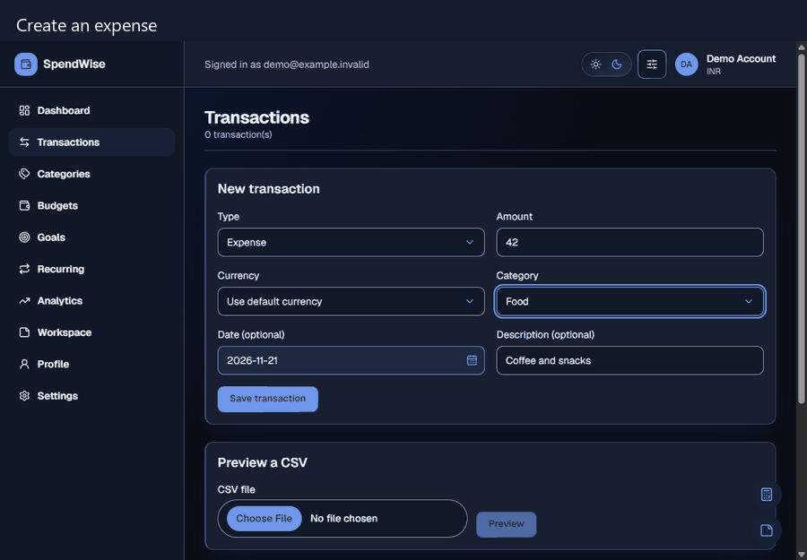

# SpendWise

SpendWise is a personal finance and spending tracker built with the MERN stack and TypeScript. I am building it as a full-stack learning project, one feature at a time.

## Transactions demo



The demo uses sample data. Create an expense, edit its amount, and find it by category and date. The budget reflects the change without a browser reload.

## Project status

**57% on the roadmap tracker as of 2026-11-22.** The tracker marks 8 of 18 phases complete, 3 in progress, and 7 pending. It measures configured file milestones.

## Features

| Area | Available in the workspace |
|---|---|
| Authentication and profile | Registration, login, logout, cookie-based sessions, profile settings, password changes, and Cloudinary profile photo upload |
| Transactions and categories | Manual create, edit, and delete, currency selection, search, category and date filters, sorting, pagination, category management, and CSV preview and import |
| Planning | Monthly budgets, savings goals, contributions, and recurring transaction rules |
| Reporting | Dashboard and analytics with day and month filters, category breakdowns, historical trends, and budget spending through a selected date |
| Workspace | Notes, quick notes, linked records, and a calculator |
| Interface | Responsive filters and forms with shared dropdowns and date controls. Browser-saved Appearance settings include a continuous 1–100 theme, per-page accents, scale, spacing, corners, shadows, and motion. |

Successful transaction changes refresh the ledger, Dashboard, Analytics, and Budgets. The local recurring scheduler starts with the backend. Open **Settings** in the sidebar to customize the interface or restore defaults.

## Tech stack and structure

- **Frontend** uses React 19, TypeScript, Vite, Tailwind CSS, Redux Toolkit/RTK Query, React Hook Form, Zod, and Recharts.
- **Backend** uses Node.js, Express 5, TypeScript, MongoDB/Mongoose, JWT, bcrypt, Zod, Multer, and Cloudinary for profile photos.
- **Request flow** runs from route to controller, service, repository, and model.

| Path | Purpose |
|---|---|
| `backend/src/config/` | Environment and database configuration |
| `backend/src/routes/`, `controllers/`, `validators/` | HTTP endpoints, authentication, and input validation |
| `backend/src/services/`, `repositories/`, `models/` | Business logic and database access |
| `backend/src/queues/` | In-process recurring transaction scheduler |
| `frontend/src/pages/`, `features/` | Page views and feature-specific API clients |
| `frontend/src/components/`, `index.css` | Shared layout, controls, and themes |

## Run locally

Use Node.js 22.12 or later, npm, and a running MongoDB instance. Node.js 24 was used for local verification.

### Backend

From `SpendWise/backend`, run `npm install` and create `.env` with the following settings. Replace the two JWT placeholders with separate random values. Run the secret generator command twice and keep the output private.

```dotenv
NODE_ENV=development
PORT=5000
CLIENT_URL=http://localhost:5173
MONGODB_URI=mongodb://localhost:27017/spendwise
JWT_ACCESS_SECRET=replace-with-a-random-value
JWT_REFRESH_SECRET=replace-with-a-different-random-value
JWT_ACCESS_EXPIRY=15m
JWT_REFRESH_EXPIRY=7d
```

```sh
node -e "console.log(require('node:crypto').randomBytes(32).toString('hex'))"
npm run dev
```

For a compiled local run, use `npm run build` followed by `npm start`. The health check is `http://localhost:5000/health`.

### Frontend

In a separate terminal, run `npm install` and `npm run dev` from `SpendWise/frontend`. Open `http://localhost:5173`. To point the local frontend to another API, set `VITE_API_URL` in `frontend/.env.development` and restart Vite.

### Profile photo setup

Set `CLOUDINARY_CLOUD_NAME`, `CLOUDINARY_API_KEY`, and `CLOUDINARY_API_SECRET` in the backend environment to enable profile photo uploads. The backend signs requests and accepts JPEG, PNG, WebP, and HEIC/HEIF up to 5 MB. Keep Cloudinary credentials in the backend.

## Production configuration

- **Backend** takes settings from `backend/.env.production` or host-provided environment variables. Set the HTTPS frontend origin in `CLIENT_URL`, configure MongoDB and dedicated JWT secrets, then build and run `npm run start:production`.
- **Frontend** reads `frontend/.env.production` or build-time environment variables during `npm run build`. By default, serve the frontend over HTTPS and forward `/api/*` to Express on the same origin. Set `VITE_API_URL` at build time when using a separate same-site API origin.
- Keep actual environment files, database credentials, tokens, and API secrets out of Git. All `VITE_*` variables are public.

## Verification and roadmap

The backend health endpoint, frontend build and lint, and a signed-in Chrome test against local Express and MongoDB passed. The test covered transaction creation, editing, filters, deletion, and refreshed Dashboard and Budgets totals. Live Cloudinary upload and full CSV end-to-end verification are still pending.

Next on the roadmap are notifications, Redis caching, RabbitMQ, real-time features, automated tests, Docker, CI/CD, and AWS deployment.

## License

Personal learning project. Redistribution rights are reserved.
